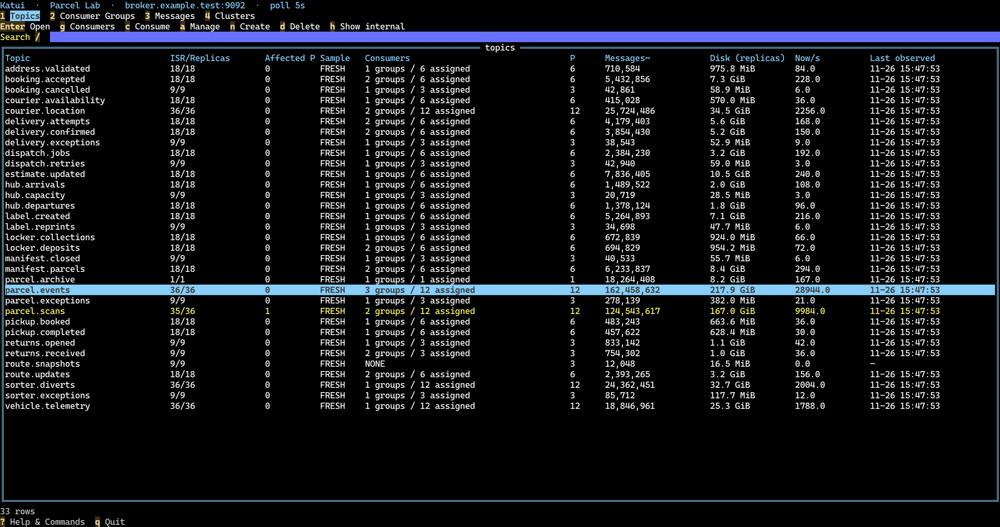
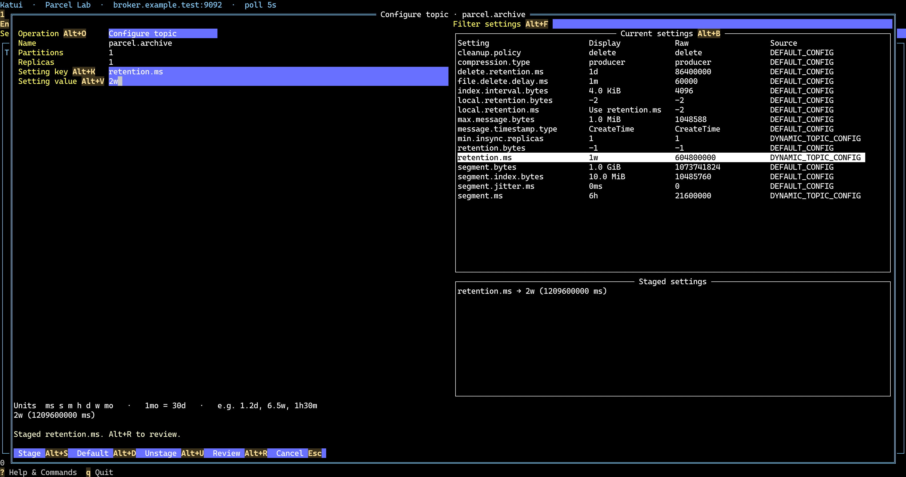
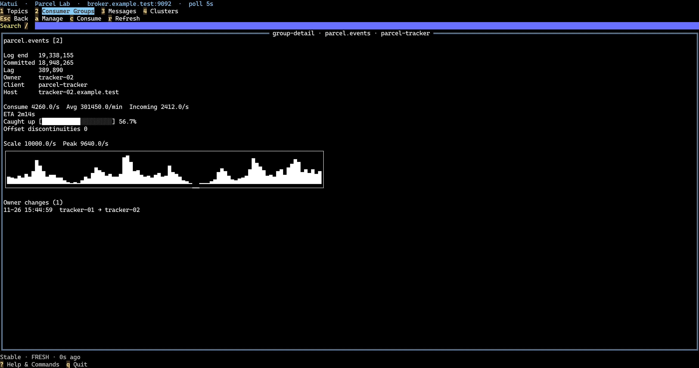
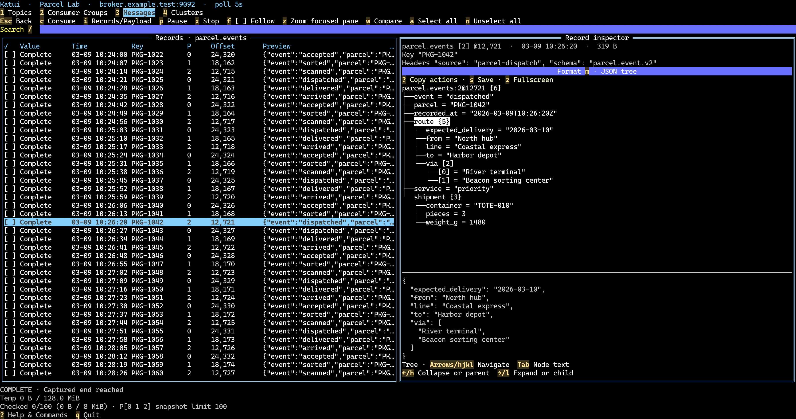

# Katui

Katui is a terminal UI for Apache Kafka.

## Features

- **Manage connections.** Save broker addresses in cluster profiles and switch between them. Connect with TLS, client certificates, or SASL authentication.
- **Monitor topics and groups.** Check replica health, disk usage, per-partition lag, throughput history, and catch-up estimates.
- **Read records.** Follow live messages or start at a timestamp or offset. Search, compare, copy, and export records.
- **Inspect payloads.** Pretty-print JSON or explore it as a tree. View CSV as a table or pivot, and decode Protobuf using local schemas.
- **Administer Kafka.** Create, configure, or delete topics, set retention in human-readable units, reset group offsets, and request rebalances. Review changes before applying them.



The screenshots use fictional data from a parcel delivery service.

## Build and install

With Go 1.26.11 or newer, run `make install` from the repository root. Add `$HOME/.local/bin` to your `PATH` and start `katui`. To run without installing, use `make` and `./bin/katui`. Set `PREFIX` or `BINDIR` to install elsewhere.

## Connect

Start `katui` to enter broker addresses or choose a saved cluster. Use **Connect** (Alt+C) to open the cluster. Select **Save profile** to reuse the connection. Katui prompts for a SASL password on reconnect unless you select **Remember password**, which writes it unencrypted to your private profile file.

To reuse a Kafka `.properties` file, choose **Import Kafka properties…** (Alt+I) in **Connect to Kafka**. Pick the file, review the populated form, and choose **Connect**. If the file omits `bootstrap.servers`, Katui keeps the brokers already in the form. You can enter them there too. Importing leaves **Remember password** off.

```sh
katui -b broker.example.net:9092
katui --cluster staging -g billing -t orders
katui --cluster staging --once -t orders -p 1
```

Use `--once` for a JSON snapshot. Pass `-g` for group offsets or `-t` for topic offsets. With neither flag, Katui lists consumer groups. Use `--help` for all options.

<details>
<summary>TLS, SASL, and supported connection files</summary>

Katui supports TLS with optional client certificates, SCRAM-SHA-256, SCRAM-SHA-512, and PLAIN over TLS. Imported PEM truststores use only the supplied CA file.

The importer accepts connection settings such as `security.protocol`, file-based PEM truststores and keystores, and SCRAM or PLAIN credentials from a simple `sasl.jaas.config`. For a PEM store, set `ssl.truststore.type=PEM` or `ssl.keystore.type=PEM` and the corresponding `.location`. Relative paths start in the properties file’s directory. Import stops on unsupported keys or store types, including JKS and PKCS#12.

For a JSON connection file, pass `--client-config path/to/client.json`.

```json
{
  "tls": true,
  "ca_file": "/path/to/ca.pem",
  "sasl": {
    "mechanism": "SCRAM-SHA-512",
    "username": "username",
    "password": "password"
  }
}
```

Omit fields you do not use. By default, a native JSON configuration adds `ca_file` to the system trust roots. For mutual TLS, set both `cert_file` and `key_file`. Use `--size-client-config` for separate disk-query credentials. Your machine must be able to reach the advertised broker addresses as well as the bootstrap address.

</details>

## Use

Press `1` for Topics, `2` for Consumer Groups, `3` for Messages, and `4` for Clusters. Use `/` to search, Enter to open, Esc to go back, and Tab to move focus. Press `?` for commands and `?` again for keyboard shortcuts. In Clusters, Enter connects, `e` edits a profile, and `n` starts a new connection.

### Check topic replication

**ISR/Replicas** totals in-sync replicas across a topic. **Affected P** counts partitions missing a replica or leader. Yellow means one replica is missing on at least one partition. Red means a partition has no leader, no in-sync replica, or at least two missing replicas. Open the topic to see which partition needs attention. A `?` marks incomplete metadata, `≥` gives a lower bound on affected partitions, and `stale` marks the last known observation.

### Configure topic retention

From Topics, press `a` and choose **Configure topic**. Press Alt+B, select `retention.ms`, then press Enter. In the example, **Display** shows `1w` and **Raw** shows `604800000`. Enter `2w` and press Alt+S to stage 1,209,600,000 milliseconds. You can also enter `90s`, `1h30m`, `1.2d`, or `6.5w`. Use `m` for minutes and `mo` for fixed 30-day months.



From Topics, `n` opens creation and `d` opens deletion. From Consumer Groups, `a` opens offset resets, group deletion, and rebalances. The group must be empty before you reset its offsets or delete it. Rebalancing removes the current members of a classic consumer group so they can rejoin. For any administrative change, press Alt+R to review, type the exact target name, and press Alt+A to apply. If a write times out or partially succeeds, check the resulting state before reviewing again.

<details>
<summary>Editing and confirming changes</summary>

In **Configure topic**, Alt+F filters the settings list and Alt+B focuses the results. Alt+D stages a return to the broker default and Alt+U unstages a change. A displayed `≈` indicates rounding. Review shows the exact value sent to Kafka.

Review and Apply check the cluster identity and the state of the target. If either has changed since review, open a fresh review before applying.

</details>

### Monitor consumer rates

Open a consumer group, then a partition, to see its lag, owner, consumption rate, and catch-up ETA. Katui samples opened groups every five seconds by default, including while you browse elsewhere. Set `-i` to change the interval. The chart keeps 90 samples. A heavy mark on its bottom border is a measured zero. A blank column with an ordinary border means the sample is missing. An **Offset discontinuity** means the committed offset or log end moved backward. Katui starts a new rate history and lag baseline for that partition. Switching clusters or quitting ends background sampling.



### Inspect, copy, and export payloads

From a topic or partition, press `c`, toggle partitions with Space, choose where to start, and press Alt+C. Read from the end, recent offsets, the retained beginning, a timestamp, or an exact offset. Select a single partition to look up a specific record. Exact offsets are inclusive. If an offset falls in a gap, reading starts at the next available record. **Keep following** continues reading new arrivals. The reader fetches records without joining a consumer group or committing offsets.



- **Browse.** Use `i` to switch between records and inspector, `z` to zoom the focused pane, and `f` to follow the newest record. Space checks records in the list, `a` checks all visible records up to the selection limit, `n` clears the selection, and `w` compares checked records.
- **Decode.** Press `m` for Raw, JSON text or tree, CSV table or pivot, or Protobuf JSON or tree. CSV supports custom delimiters (`d`) and column names (`o`). Alt+H toggles the CSV header row. In Protobuf, press `u` to load a local `.proto` or descriptor set and select the message type.
- **Search and copy.** In the inspector, `/` opens fullscreen search. Use `n` and `p` for matches. Use `g` to copy the complete raw text, `.` for the rendered view, or `s` to save the retained value, including binary data. In a tree, arrows expand or collapse nodes and Tab focuses the selected node’s text.

<details>
<summary>Large payloads, selection, and local storage</summary>

The split inspector previews the first 64 KiB. Press `z` for Fullscreen, where you can expand and search the entire JSON tree, including collapsed branches. Fullscreen starts with an 8 MiB structured-input budget and a 32 MiB rendered-output budget. If the payload exceeds either, press Alt+L and Enter to load the retained value using available memory. Use `--structured-input-mib` and `--rendered-output-mib` to change the initial budgets. CSV displays up to 50,000 rows and 256 columns.

Use `--payload-storage-mib` to change the 128 MiB temporary storage quota. **Preview only** identifies a record whose complete value could not be retained. For text selection, drag with the mouse or press Space for Cursor mode, then `v` and the arrows to extend a selection. Ctrl+C copies the selected text. When using the terminal clipboard over SSH, use `s` to save values larger than 64 KiB.

Alt+Left/Right pans eight columns. Ctrl+Left/Right pans half a viewport. In Cursor mode, `0` and `$` jump to the beginning and end of a line. Selecting text pins the current record while new messages arrive. Press `f` to follow again.

Saved profiles and inspector preferences live in `$XDG_CONFIG_HOME/katui/` (default `~/.config/katui/`). Use `--inspector-config` to choose another inspector settings file. Cached group snapshots live in `$XDG_CACHE_HOME/katui/` (default `~/.cache/katui/`). Use `--no-cache` to disable them.

</details>

## Verification

```sh
go test -race ./...
go vet ./...
govulncheck ./...
```

To include broker integration tests, set `KATUI_TEST_BROKER` to a disposable Kafka broker. These tests create, configure, and delete topics, produce records, and change consumer groups and offsets.
